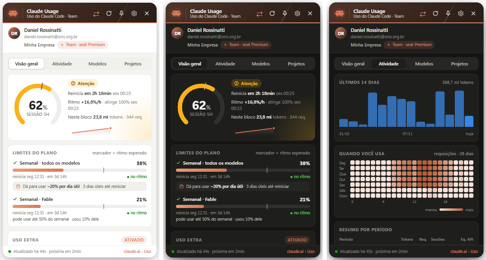
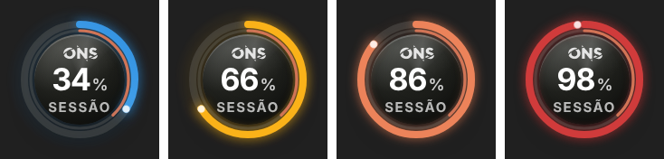

# Claude + Codex Usage

Widget de desktop (Windows e macOS) que mostra o uso do **Claude Code** em qualquer assinatura do Claude (individual **Pro**/**Max** ou organizacional **Team**/**Enterprise**) e, no mesmo app, o uso do **Codex** conectado ao ChatGPT. Um ícone animado fica no canto da tela; ao clicar, abre o painel com o uso atualizado. Alterne entre as duas IAs com o botão **⇄** ou com **PgUp**.




## O que aparece

| Fonte | Dados |
|---|---|
| **Limites do plano** (API OAuth do Claude Code, a mesma do comando `/usage`) | Sessão atual (janela de 5h) com % usado e horário do reset. Limite semanal de todos os modelos. Limites semanais por modelo (Opus, Sonnet etc.). Uso extra pago (créditos/mês). Projeção de quando você atinge 100% no ritmo atual. Marcador de "ritmo linear" em cada barra |
| **Conta** (`/api/oauth/profile`) | Nome, e-mail, organização (quando houver), plano e tier (5×/20× no Max, tipo de seat no Team/Enterprise) |
| **Logs locais** (`~/.claude/projects/**/*.jsonl`) | Tokens por tipo (entrada, saída, cache) e por modelo. Projetos mais usados. Sessões ativas. Gráfico de 14 dias e mapa de calor dia × hora. Ritmo em tokens/min. Custo equivalente em API (estimativa) |
| **Codex** (`~/.codex/sessions/**/*.jsonl` e `auth.json`) | Limites de 5h e semanal com % usado e horário do reset, nome, e-mail e plano da conta ChatGPT, tokens, atividade, modelos e projetos. Veja [Modo Codex](#modo-codex) |

Também tem:

- **Notificações nativas** ao passar de 75% ou 90% (limiares configuráveis). No limite próprio do Fable, a notificação sugere usar Opus/Sonnet no que não precisar dele.
- **Avisos da sessão de 5h:** "faltam 15 min para reiniciar" e "sessão reiniciada, pode voltar a usar" (só quando a sessão tinha passado do primeiro limiar).
- **Ritmo semanal:** quanto dá para usar por dia útil até o reset semanal (sábado e domingo não contam) e aviso de "acima do ritmo".
- **Status do Claude:** consulta `status.claude.com` a cada 5 min. Com instabilidade, aparece um aviso no painel e um ponto pulsante no widget.
- **Atalho global:** `Ctrl + Alt + U` (`⌘⌥U` no macOS) abre e fecha o painel.
- **Dois estilos de widget:** o **círculo** flutuante, que você arrasta para onde quiser, ou a **ilha**, uma pílula preta no estilo da Ilha Dinâmica do iPhone, centralizada no topo, na base ou numa lateral da tela. Fechada, a ilha mostra a logo e o % e deixa os cliques passarem para o que está embaixo. Ao parar o mouse em cima, ela se expande com os limites de sessão e semana e os botões Alternar, Atualizar, Painel e Ajustes. Escolha em **Configurações → Widget flutuante**.
- **Claude e Codex no mesmo app:** o botão **⇄** do painel ou a tecla **PgUp** (configurável) alternam a IA exibida no painel, no widget e na bandeja.
- **Modo apresentação:** o widget some quando outro app está em tela cheia ou apresentando (Windows) e não aparece em compartilhamento de tela, gravações e prints (Windows 10 2004+ e macOS).
- **Ícone na bandeja** (Windows) ou na barra de menus (macOS) com o percentual.
- **Iniciar com o sistema.**
- **Tema claro/escuro** seguindo o sistema, com opção de forçar um dos dois. Cada IA tem a sua cor: laranja para o Claude e azul para o Codex.
- **Animações:** anel com halo pulsante, contador animado, gráficos com transição e opção de reduzir movimento.

## Modo Codex

### Alternar Claude e Codex

Use o botão **⇄** no cabeçalho do painel, ou pressione **PgUp** em qualquer aplicativo. A seleção é compartilhada entre as janelas e salva entre execuções. Em **Configurações → Claude / Codex**, clique no atalho e pressione a nova tecla ou combinação. Esc cancela; o botão PgUp restaura o padrão. Se outra aplicação já usa o atalho, o painel avisa para escolher outra combinação.

Claude usa o tema laranja; Codex usa o azul e a logo do ChatGPT. Os temas claro, escuro e do sistema continuam disponíveis. O anel do widget usa a cor da IA até 90% de uso e fica vermelho apenas acima de 90%.

### De onde vêm os dados

O Codex não tem API de uso, então o app lê os eventos das sessões em `~/.codex/sessions` (ou `CODEX_HOME/sessions`) a cada 30 segundos. Tokens, atividade, modelos e projetos usam esses logs; custos de API não são estimados para o Codex. A leitura não modifica credenciais nem sessões.

Os limites de 5 horas e semanal refletem o **último registro local**, com aviso quando estiver antigo. Abra e use o Codex conectado ao ChatGPT para produzir esses registros.

**Janela vencida:** sem uso do Codex, o último registro continua no log com um horário de reset que vai ficando no passado. Quando esse horário passa, o app mostra a janela em **0%, sem horário de reset** (no painel, "sem reset informado"), em vez de uma contagem travada em "0s". A próxima janela só começa no próximo uso, e os valores reais voltam a aparecer assim que o Codex gravar um novo registro.

### Perfil da conta

O painel do Codex mostra nome, e-mail, iniciais e plano no mesmo layout do Claude. Os campos de perfil são lidos do login local em `CODEX_HOME/auth.json` (ou `~/.codex/auth.json`) e atualizados a cada ciclo de leitura. Apenas nome, e-mail e plano são enviados à interface. Se esse arquivo ou os dados de perfil não estiverem disponíveis, o painel mostra uma identificação genérica da conta.

## Privacidade: tudo é local

- O app só **lê** o login que o Claude Code já salvou: `%USERPROFILE%\.claude\.credentials.json` no Windows, Keychain "Claude Code-credentials" no macOS. Ele nunca grava nem renova esse token.
- As chamadas de rede são para `api.anthropic.com` (`/api/oauth/usage` e `/api/oauth/profile`), a mesma que o próprio Claude Code faz, e para a página pública `status.claude.com/api/v2/summary.json` (sem credencial; dá para desligar nas configurações). Não existe servidor intermediário.
- No modo Codex o app só **lê** os logs de sessão e o `auth.json` locais do Codex, e envia à interface apenas nome, e-mail e plano. Tokens e credenciais nunca saem do back-end, e o Codex não gera nenhuma chamada de rede.
- Configurações e cache ficam em `%APPDATA%\com.claudeusage.widget` (Windows) ou `~/Library/Application Support/com.claudeusage.widget` (macOS).

## Requisitos de uso

1. Claude Code instalado e **logado com sua conta Claude** (rode `claude` uma vez e faça login). Funciona com contas pessoais e de organização.
2. *(opcional)* Codex conectado ao ChatGPT neste computador, para o modo Codex.
3. Windows 10 (versão 1809 ou mais nova) ou 11, com o Microsoft Edge WebView2 Runtime, que já vem no Windows 11 e na maioria dos Windows 10 atualizados. Nada mais precisa ser instalado: o .exe já inclui o runtime do Visual C++. No macOS, versão 11 ou mais nova.

> O token OAuth expira mais ou menos a cada hora, e o Claude Code renova sozinho quando está em uso. Se você ficar horas sem usar o Claude Code, o painel mostra a última leitura e avisa. Basta abrir o Claude Code para o app voltar a atualizar.

## Como gerar o executável

### Windows (um único `.exe`)

```powershell
powershell -ExecutionPolicy Bypass -File .\build-windows.ps1
```

O script instala o que faltar via `winget` (Node.js, Rust e VS Build Tools C++) e compila. A saída fica em `release\`:

- `Claude + Codex Usage.exe`: executável único (~6–10 MB), roda sem instalar.
- `Claude + Codex Usage_1.0.0_x64-setup.exe` / `.msi`: instaladores, opcionais.

### macOS

```bash
./build-macos.sh   # gera .app e .dmg universais (Apple Silicon + Intel)
```

### Pelo GitHub Actions

O workflow `.github/workflows/build.yml` gera os pacotes de Windows e macOS. Para rodar, use **Actions → Build → Run workflow** ou crie uma tag `v*`.

## Problemas comuns

**`CRYPT_E_NO_REVOCATION_CHECK` / `SSL connect error` ao compilar.** Algumas redes corporativas bloqueiam a consulta de revogação de certificados que o `cargo` faz no Windows. O `build-windows.ps1` já desliga essa consulta (`CARGO_HTTP_CHECK_REVOKE=false`). Se você compilar manualmente, rode `$env:CARGO_HTTP_CHECK_REVOKE="false"` antes ou crie `%USERPROFILE%\.cargo\config.toml` com:

```toml
[http]
check-revoke = false
```

**Os instaladores falham, mas o .exe foi gerado.** O empacotamento baixa o NSIS e o WiX da internet. Use `.\build-windows.ps1 -SemInstalador` para gerar só o executável portátil.

**O app não abre e não aparece no Gerenciador de Tarefas.** Veja se existe `%LOCALAPPDATA%\com.claudeusage.widget\erro.log`:
- **Não existe:** o Windows impediu o .exe de rodar (SmartScreen, Controle Inteligente de Aplicativos ou antivírus da TI, porque o .exe não tem assinatura digital). Clique com o botão direito no .exe → Propriedades → marque "Desbloquear", ou peça liberação à TI.
- **Existe:** a última linha diz o motivo e a memória livre no momento. Sem o WebView2 ou com erro na abertura, o app agora mostra uma mensagem em vez de sumir.

**"Este computador não tem o Microsoft Edge WebView2 Runtime".** O app oferece abrir a página de download da Microsoft. O instalador (`*-setup.exe`) instala o WebView2 sozinho; o .exe portátil não.

**Ao ligar o PC abre "localhost se recusou a se conectar".** O Windows estava iniciando a versão de desenvolvimento (`npm run tauri dev`). Feche-a pela bandeja e abra o `release\Claude + Codex Usage.exe` uma vez: ele corrige o registro de inicialização.

**O app mostra "Sem conexão" em rede corporativa.** O app usa o repositório de certificados do Windows/macOS (inclui a CA corporativa) e o proxy configurado no sistema. Se o proxy usar script PAC, defina `HTTPS_PROXY` nas variáveis de ambiente do usuário.

## Desenvolvimento

```bash
npm install
npm run dev        # interface no navegador com dados de demonstração (http://localhost:1420)
npm run app:dev    # app completo (Tauri) com hot-reload
cargo test --manifest-path src-tauri/Cargo.toml
```

No modo navegador dá para simular estados pela URL: `?view=widget&five=92`, `?view=panel&error=auth`, `?view=panel&plan=team` (conta de organização; o padrão é uma conta individual Max).

Para inspecionar o que o back-end está lendo, rode com `CLAUDE_USAGE_DEBUG=1`. O snapshot completo sai no stderr a cada ciclo.

### Arquitetura

```
src-tauri/ (Rust, dentro do mesmo executável)
  credentials.rs   lê o token OAuth do Claude Code (arquivo / Keychain / env)
  api.rs           /api/oauth/usage e /profile, com User-Agent do claude-cli
  local_stats.rs   leitura incremental dos .jsonl (offset por arquivo, dedup por message.id+requestId)
  poller.rs        loop: logs a cada 30s, API no intervalo configurado, backoff em 429, notificações
  windows.rs       widget/painel: posição por monitor, área útil, arrastar, auto-ocultar
  tray.rs          ícone/menu da bandeja, tooltip com %
  codex.rs         leitura incremental de ~/.codex/sessions (limites, tokens, perfil do auth.json)
src/ (TypeScript + CSS, sem framework, ~35 KB)
  views/widget.ts  anel animado (sessão + semana), clique abre / arrastar move
  views/panel.ts   painel com abas: Visão geral, Atividade, Modelos, Projetos e Configurações
  lib/provider.ts  escolhe o snapshot do Claude ou do Codex conforme a IA selecionada
  lib/normalize.ts interpreta o payload de uso de forma tolerante (campos novos aparecem sozinhos)
```

**Por que Tauri 2:** usa o WebView do sistema em vez de embutir um Chromium. O binário fica em ~6–10 MB e usa ~30–50 MB de RAM, contra 150 MB+ do Electron. A lógica fica em Rust nativo.

### Observações

- `/api/oauth/usage` é o endpoint usado pelo Claude Code, mas **não é documentado publicamente**. O parser aceita campos novos ou ausentes. Se a Anthropic mudar o formato, só `src/lib/normalize.ts` precisa de ajuste.
- O intervalo mínimo de consulta é 1 min (padrão 3 min). Ao receber 429, o app espera progressivamente até 15 min.
- O "custo eq. API" é só comparativo: na assinatura o valor é fixo.

### Logos

A marca do Claude fica em `src/assets/brand/claude-logo.svg` (opcionalmente `claude-logo-dark.svg` para o tema escuro). Detalhes em `src/assets/brand/LEIA-ME.md`.
